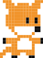
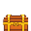
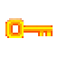

# Make your own game

Move a character with the **arrow keys**, then make it your own!
Ask your grown-up to help with the setup below first.

## Set up once

Install [uv](https://docs.astral.sh/uv/getting-started/installation/) and
[VS Code](https://code.visualstudio.com/), then run these commands in this folder:

```sh
uv sync --locked
code .
```

This installs Python 3.12 and the game dependencies. The pictures are already included.
Open the whole folder in VS Code so it can find the game task and editor settings.

## Play

1. Open this folder in VS Code, then open **game.py**.
2. Press **Ctrl+Shift+B**. Click the game window and use the arrow keys.
3. Close the game window before running again.

## Pick a character

Find this line in `game.py`:

```python
player = Actor("dragon_awake", (320, 240))
```

Change `"dragon_awake"` to `"fox"` or any name below. Keep the quotes; leave off `.png`.
Press **Ctrl+S** to save, then **Ctrl+Shift+B** to play again.

| Characters | Animals | Objects |
| --- | --- | --- |
|  `hero` |  `fox` |  `chest` |
|  `hero2` |  `hedgehog` |  `key` |
|  `dancer` |  `bird` |  `coin` |

These are a few favourites — [browse all 34 pictures](images/) for dragons, doors, walls, and more!
All pictures are in the **images** folder. An `Actor` is a picture with a position.

## Try a change

- Change the `4` in the movement lines to `2` or `8` to move slower or faster.
- Change `screen.fill("white")` to `screen.fill("purple")` for a new background.

Save, close the old game, and run again. **Ctrl+Z** undoes an edit if you get stuck.

## Add a chest

Add this line just below the `player = Actor(...)` line:

```python
chest = Actor("chest", (450, 240))
```

Then make `draw()` look like this. Keep the four spaces before each line inside it:

```python
def draw():
    screen.fill("white")
    player.draw()
    chest.draw()
```

Your chest stays still while you move. Try changing its picture to `"chest_open"`!
The first number goes across the screen; the second goes down.

## Build some ground

Add these two lines below your Actor lines:

```python
ground1 = Actor("grass", topleft=(384, 320))
ground2 = Actor("grass", topleft=(448, 320))
```

Then add these lines inside `draw()`, just after `screen.fill("white")`:

```python
    ground1.draw()
    ground2.draw()
```

The tiles are 64 pixels wide, so their left positions are 64 apart. They meet without a gap!
Try `"wall"`, `"floor"`, or `"dirt"` instead of `"grass"`.
These are scenery pictures for now: your character can move through them.

Artwork from the DK book resource pack, plus newly generated scenery — see [sprite credits](images/CREDITS.md).
